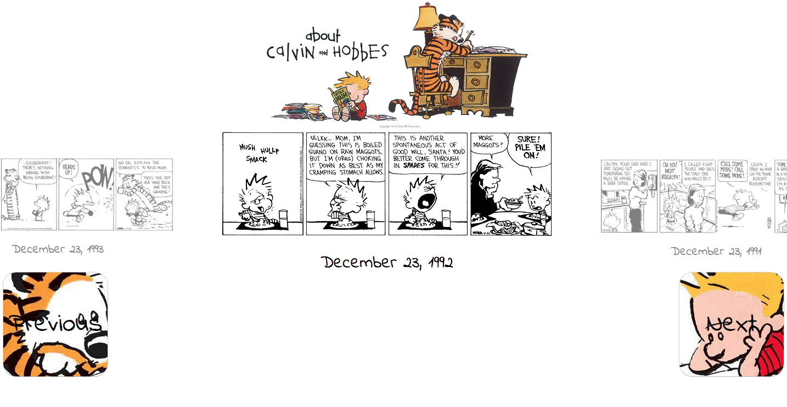

# The Calvin and Hobbes Encyclopedia



A beautiful animated carousel showcasing Calvin and Hobbes comic strips pulled from Tumblr's API.

## Features

* Tumblr's [API](https://www.tumblr.com/docs/en/api/v2) pulls over 3,900 blog posts each containing 20 strips
* Smooth animated carousel navigation created with CSS
* Responsive design that works on all screen sizes
* Built with [React](https://reactjs.org/)

## Development

### Prerequisites
- Node.js 20+
- npm or yarn

### Local Setup

1. Clone the repository
```bash
git clone https://github.com/philkrause/calvin-and-hobbes-encyclopedia.git
cd calvin-and-hobbes-encyclopedia
```

2. Install dependencies
```bash
npm install
```

3. Start the development server
```bash
npm start
```

The app will open at [http://localhost:3000](http://localhost:3000)

### Build for Production
```bash
npm run build
```

## Deployment

### Deploy to Vercel

[](https://vercel.com/new/clone?repository-url=https://github.com/philkrause/calvin-and-hobbes-encyclopedia)

Or via CLI:
```bash
npm install -g vercel
vercel
```

### Deploy to Netlify

The project includes a `_redirects` file for Netlify deployment.

```bash
npm install -g netlify-cli
netlify deploy --prod
```

## Live Demo

[View on Netlify](https://calvinandhobbes.netlify.app)

